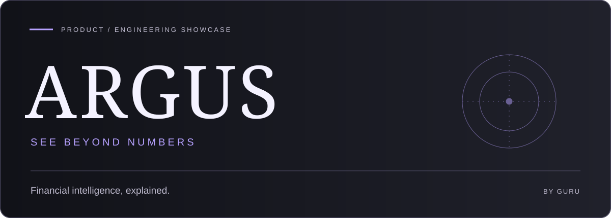
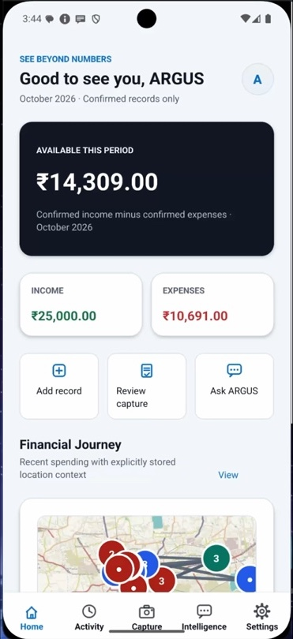
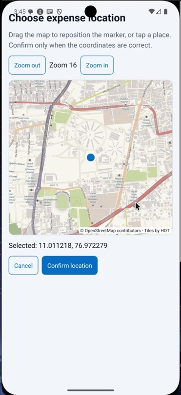
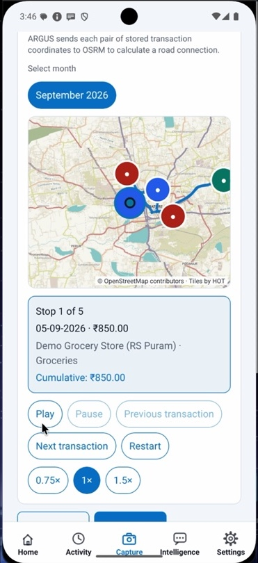
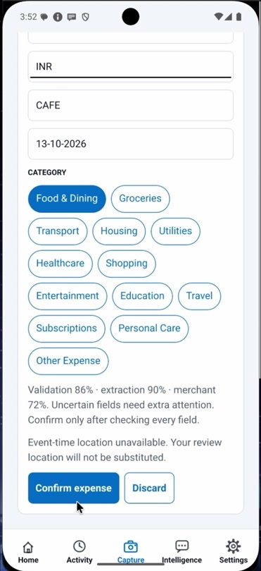

  <a href="#watch-the-demo">Watch the demo</a> &nbsp; · &nbsp;
  <a href="#the-product">The product</a> &nbsp; · &nbsp;
  <a href="#engineering-decisions">Engineering decisions</a> &nbsp; · &nbsp;
  <a href="#technical-evaluation">Technical evaluation</a>

## The product

**ARGUS: An AI-Powered Financial Intelligence Platform**

Financial applications should do more than collect numbers. ARGUS connects the
financial record with understandable context: what changed, which budget needs
attention, and where eligible spending happened.

Built with **React Native, TypeScript, Node.js and PostgreSQL**.

## Watch the demo

**[Watch / download the 3:19 ARGUS walkthrough](https://github.com/guru-six3/ARGUS-showcase/releases/download/demo-v1/ARGUS-Demo-Walkthrough.mp4)**

  
   Click the preview to open the MP4. <a href="https://github.com/guru-six3/ARGUS-showcase/releases/tag/demo-v1">Release page</a>

The recording shows manual entry, choosing an expense location, Financial Journey,
Month in Motion and transaction review. The owner has confirmed that the amounts,
merchants and locations are **synthetic demonstration data**, not personal financial history.

This is a silent, edited excerpt of the supplied application recording. Sign-in
and notification-shade segments have been removed; the original stays private.
The video demonstrates these workflows, not every feature or production-provider integration.

## Inside the application

These are actual frames from the supplied recording, not generated UI mockups.
Only the black recording borders were removed; application content was not altered.

<table>
  <tr>
    <td align="center" width="50%"> <strong>01 · Financial overview</strong> Confirmed income, expenses and balance.</td>
    <td align="center" width="50%"> <strong>02 · Choose a location</strong> An optional point the user explicitly confirms.</td>
  </tr>
  <tr>
    <td align="center"> <strong>03 · Month in Motion</strong> Reconstructed routes, not actual GPS travel history.</td>
    <td align="center"> <strong>04 · Review before saving</strong> Inspect and correct extracted evidence.</td>
  </tr>
</table>

### A record you can understand

Income and expense management, searchable transaction history, editable details,
category budgets, financial summaries and analytics.

### Capture without giving up control

Android notification acquisition and receipt OCR prepare editable evidence.
The review flow lets the user correct information before confirmation. Payment
correlation is conservative: corroborating reports must not become extra expenses.
SMS acquisition relies on Android messaging notifications, not SMS database access.

### Financial Journey

Location-backed expenses on a geographic map, with user correction and deletion.
Month in Motion replays eligible completed-month expenses using reconstructed
road routes where available. These are **not actual GPS travel histories**.

### Explanations, not invented certainty

Ask ARGUS, budget warnings, recommendations and reminders use confirmed ledger
information with deterministic fallback. ARGUS does not train its own LLM, and
guidance is informational rather than a guaranteed financial outcome.

## Engineering decisions

| Decision                                             | Why it matters                                                          |
| :--------------------------------------------------- | :---------------------------------------------------------------------- |
| Server-authoritative, owner-scoped financial records | One user's data must never become another user's context.               |
| Decimal-safe financial values and explicit currency  | Financial totals need predictable, auditable calculation.               |
| Rotating refresh sessions and native secure storage  | Authentication is more than a successful login screen.                  |
| Preserved notification event context                 | A later review location must not replace the event's original evidence. |
| Opt-in location with unavailable states              | Missing evidence should stay missing, never become a fabricated point.  |
| Provider boundaries and honest fallback              | External services can change without changing financial truth.          |
| Explicit errors, retry paths and save feedback       | Users need to know whether an action actually persisted.                |

## Project status

This is a development project with automated tests, database/bootstrap validation
and Android emulator acceptance evidence. Physical-device and production-release
acceptance are separate gates, not implied by a successful build.

The application is not a fully offline or publicly hosted service. Its normal
financial features require the API and database. Phone OTP is frozen for the
current review UI. iOS cannot provide general cross-app notification listening.

## Technical evaluation

The full source repository is intentionally private. This repository is a public
product and engineering overview, not an open-source distribution or an APK download.

**Source review and a guided walkthrough are available to potential employers on request.**

[Get in touch on LinkedIn](https://www.linkedin.com/in/gurusundaragunalan-m/)
&nbsp; · &nbsp; [Explore Guru's other projects](https://github.com/guru-six3)

Do not post financial information, credentials or personal contact details in
public issues. Access to private source is granted individually, not automatically.
